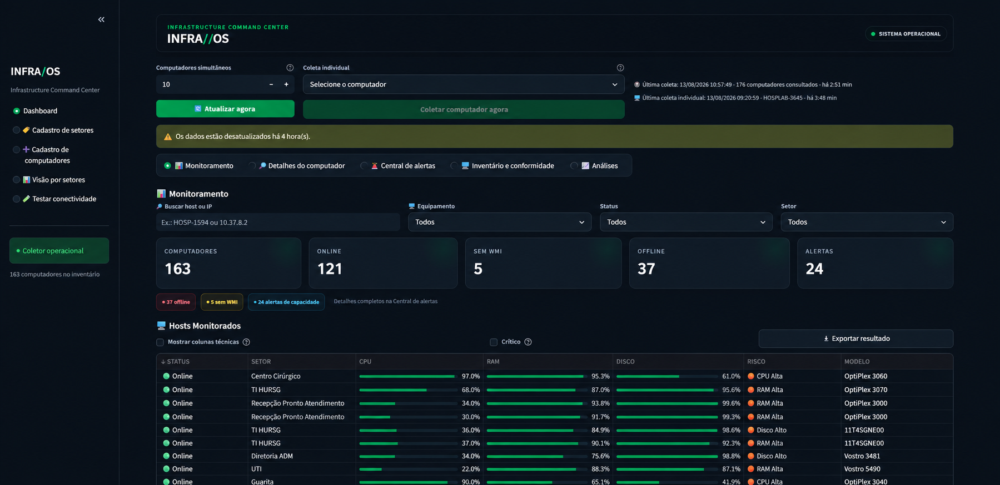
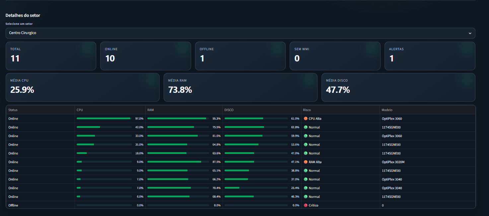
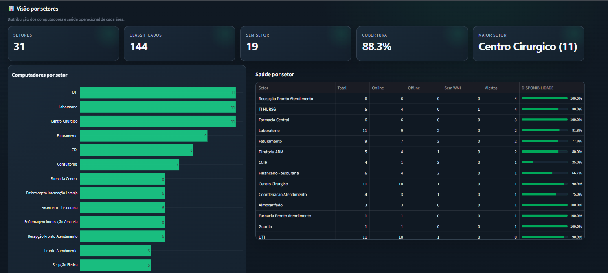
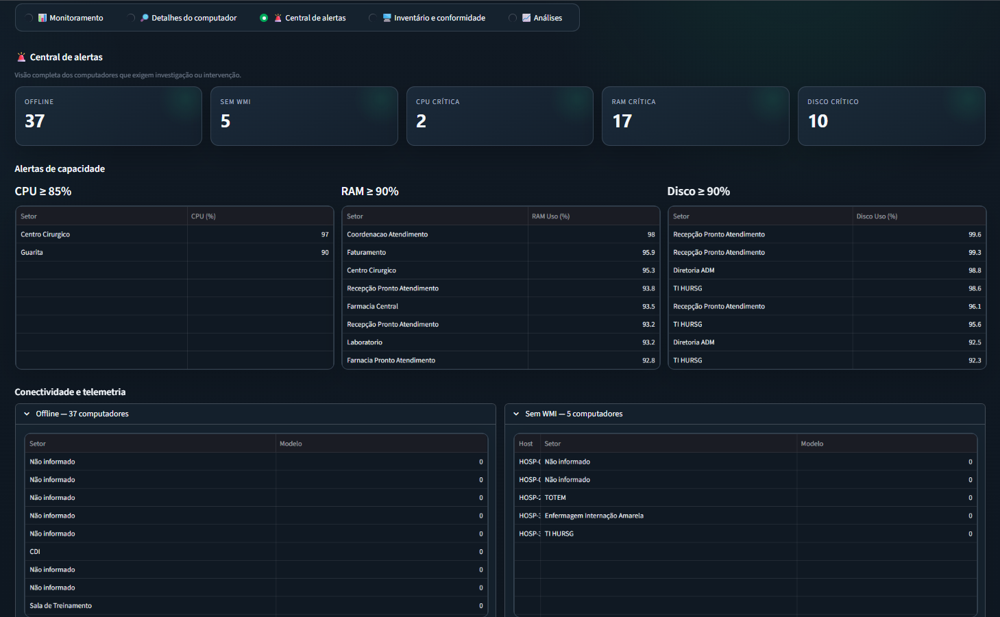
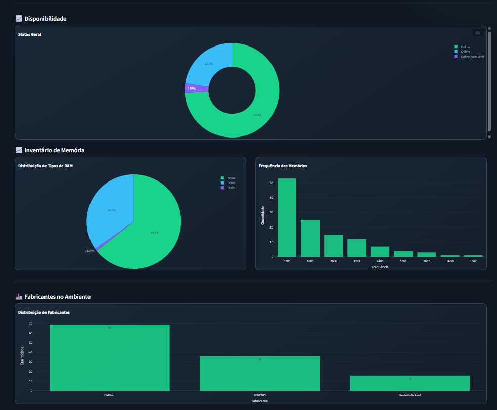

# InfraOS

## InfraOS — Monitoramento e inventário de infraestrutura

## Visão geral

O **InfraOS** é um dashboard interno de inventário e monitoramento de computadores Windows, desenvolvido com Python e Streamlit.

A plataforma reúne, em uma interface centralizada, informações coletadas remotamente por WMI, como disponibilidade, uso de CPU, memória e disco, sistema operacional, usuário conectado, fabricante, modelo, número de série e características de hardware.

Além do acompanhamento operacional, o InfraOS permite organizar os computadores por setor, testar a conectividade antes do cadastro, incluir equipamentos manualmente e preservar o histórico de patrimônios inativados.

> O projeto trabalha com informações sensíveis da infraestrutura interna. Não publique inventários, endereços IP, nomes de computadores, usuários, credenciais ou arquivos de backup.



## Gestão por setores

O InfraOS permite organizar o inventário por setor, acompanhar indicadores consolidados e consultar os equipamentos vinculados a cada área.





## Alertas e análises

As centrais de alertas e análises ajudam a priorizar computadores com consumo elevado de recursos, falhas de comunicação ou necessidade de intervenção técnica.





## Principais funcionalidades

### Monitoramento

- Visão consolidada dos computadores monitorados.
- Indicadores de equipamentos online, offline e online sem WMI.
- Pesquisa por hostname ou endereço IP.
- Filtros por equipamento, status, setor e criticidade.
- Destaque visual para computadores online.
- Ordenação inicial com equipamentos online no topo.
- Barras de utilização de CPU, RAM e disco.
- Classificação de risco e alertas operacionais.
- Exportação dos resultados exibidos.

### Inventário de computadores

- Coleta remota de informações via WMI.
- Sistema operacional e tempo de atividade.
- Processador, frequência e quantidade de núcleos.
- Memória instalada, memória livre, slots e frequência.
- Uso do disco.
- Fabricante, modelo e número de série.
- Usuário conectado.
- Consulta detalhada de um computador selecionado.

### Setores e organização

- Cadastro e exclusão controlada de setores.
- Associação manual de computadores aos setores.
- Correção posterior de associações incorretas.
- Filtro de equipamentos por setor.
- Indicadores de total, online, offline, sem WMI e alertas por setor.
- Médias de CPU, RAM e disco por setor.
- Ranking de setores por quantidade de computadores.
- Relação de computadores ainda não associados a um setor.

### Cadastro e conectividade

- Cadastro manual de computadores ausentes do arquivo DHCP.
- Validação do endereço IP.
- Teste de ping/ICMP.
- Teste de RPC pela porta TCP 135.
- Consulta WMI antes do cadastro.
- Suporte a computadores que bloqueiam ping, mas respondem via RPC/WMI.
- Prevenção de hostnames e endereços IP duplicados.
- Correção de IP quando o DHCP aponta para um endereço antigo.

### Patrimônios inativos

- Inativação com motivo e confirmação obrigatória.
- Preservação do inventário e do histórico.
- Exclusão dos patrimônios inativos das próximas coletas.
- Liberação do endereço IP para outro equipamento.
- Lista de patrimônios inativos.
- Reativação controlada.
- Registro dos eventos de inativação e reativação.

### Alertas e análises

- Alertas de CPU elevada.
- Alertas de memória crítica.
- Alertas de disco crítico.
- Identificação de computadores online sem acesso WMI.
- Centralização dos equipamentos que exigem ação técnica.
- Indicadores visuais de normalidade, atenção e criticidade.

## Tecnologias

- Python 3.11+
- Streamlit
- Pandas
- WMI e COM no Windows
- PyWin32
- PowerShell e comandos administrativos do Windows
- ICMP/ping e RPC pela porta TCP 135
- HTML e CSS personalizados
- Arquivos CSV para persistência local
- Git e GitHub para versionamento

## Arquitetura

```text
Navegador
   |
   +-- Streamlit (dashboard InfraOS)
           |
           +-- Arquivos CSV
           |      +-- Inventário
           |      +-- DHCP
           |      +-- Setores
           |      +-- Cadastros manuais
           |      +-- Patrimônios inativos
           |
           +-- Coletor Python
                  |
                  +-- Ping / ICMP
                  +-- RPC / porta 135
                  +-- WMI nos computadores Windows
```

O dashboard apresenta os dados e inicia as rotinas de coleta. O coletor consulta os computadores da rede e grava o inventário somente de forma controlada, preservando os dados anteriores quando uma execução falha.

## Executando localmente

### Pré-requisitos

- Windows 10 ou Windows 11.
- Python 3.11 ou superior.
- Acesso de rede aos computadores monitorados.
- Permissões administrativas adequadas para consultas WMI.
- WMI, RPC e regras de firewall corretamente configurados nos computadores remotos.
- Git, caso o projeto seja obtido pelo repositório.

### Instalação

```powershell
git clone <URL_DO_REPOSITORIO>
cd InfraOS

python -m venv .venv
.\.venv\Scripts\Activate.ps1
python -m pip install --upgrade pip
pip install -r requirements.txt
```

### Inicialização

```powershell
streamlit run app.py
```

O endereço local padrão do Streamlit é:

```text
http://localhost:8501
```

## Preparação dos computadores remotos

Para que a coleta completa funcione, o computador remoto deve:

- estar acessível pela rede;
- permitir comunicação RPC;
- possuir o WMI ativo;
- permitir as regras necessárias no Firewall do Windows;
- aceitar as credenciais utilizadas pela estação coletora.

Um computador pode bloquear respostas ICMP e ainda assim ser coletado. Nessa situação, o InfraOS utiliza a resposta RPC/WMI como confirmação de disponibilidade.

## Persistência e backups

Atualmente, o InfraOS utiliza arquivos CSV como armazenamento local. Esses arquivos representam o estado operacional do dashboard e devem ser tratados como dados importantes.

Antes de alterações estruturais:

1. interrompa qualquer coleta em andamento;
2. faça backup da pasta de dados;
3. preserve os arquivos de setores, cadastros manuais e patrimônios inativos;
4. valide o dashboard antes de substituir a versão anterior;
5. mantenha ao menos uma cópia fora da pasta do projeto.

Não edite os CSVs manualmente durante uma coleta.

## Segurança e privacidade

- Mantenha o repositório privado.
- Não versione inventários reais, DHCP, backups ou relatórios exportados.
- Não armazene senhas diretamente no código.
- Não publique endereços IP, hostnames, usuários ou números de série.
- Utilize uma conta técnica com apenas as permissões necessárias.
- Restrinja o acesso ao dashboard à rede interna.
- Revise o histórico do Git antes de tornar um repositório público.
- Use `.gitignore` para impedir o envio de dados operacionais.

Exemplo de itens que devem ser ignorados:

```gitignore
DADOS/*.csv
BKP/
backup-*/
*.log
.env
.streamlit/secrets.toml
__pycache__/
```

Mesmo em um repositório privado, trate os arquivos de infraestrutura como confidenciais.

## Estrutura resumida

```text
InfraOS/
├── app.py                    # Dashboard Streamlit
├── coleta.py                 # Coleta WMI e geração do inventário
├── hosts.py                  # Descoberta e preparação dos hosts
├── patrimonios.py            # Regras de inativação e reativação
├── dhcp.csv                  # Origem local de hosts do DHCP
├── logounimed.png            # Identidade visual
├── DADOS/                    # Inventário e configurações operacionais
├── tests/                    # Testes automatizados
└── backup-*/                 # Backups locais, não versionados
```

A estrutura pode variar conforme a versão instalada. Consulte o código atual antes de automatizar caminhos ou nomes de arquivos.

## Testes e validação

Antes de disponibilizar uma nova versão:

```powershell
python -m unittest discover -s tests -v
python -m py_compile app.py coleta.py hosts.py patrimonios.py
```

Também é recomendado validar manualmente:

- abertura do dashboard;
- leitura do inventário anterior;
- teste de conectividade;
- coleta individual;
- coleta geral;
- associação de setor;
- inativação e reativação;
- exportação dos resultados;
- preservação dos dados após falha simulada.

Os testes não devem modificar o inventário utilizado em produção.

## Limitações atuais

- Dependência do Windows para WMI e COM.
- Necessidade de configuração de rede, firewall e permissões administrativas.
- Persistência baseada em CSV, indicada para uma instalação local controlada.
- Informações em tempo quase real apenas após a execução de uma coleta.
- Equipamentos desligados ou inacessíveis podem aumentar o tempo total da coleta.

## Roadmap

- Otimizar a coleta com paralelismo controlado.
- Adicionar estimativa de tempo restante e métricas de duração.
- Ampliar a coleta individual e incremental.
- Evoluir a persistência de CSV para SQLite ou PostgreSQL.
- Adicionar autenticação e perfis de acesso.
- Criar auditoria detalhada das alterações administrativas.
- Ampliar a cobertura dos testes automatizados.
- Criar histórico de utilização e disponibilidade por computador.
- Adicionar notificações e relatórios programados.
- Melhorar a estratégia automatizada de backup e recuperação.

## Uso responsável

O InfraOS foi criado para apoiar o trabalho diário da equipe de TI. Antes de utilizar em outro ambiente, revise credenciais, permissões, regras de firewall, política de backups e proteção dos dados coletados.

## Autor

Desenvolvido por **Alison S. Nascimento** como projeto de monitoramento, inventário e evolução da gestão de infraestrutura de TI.
